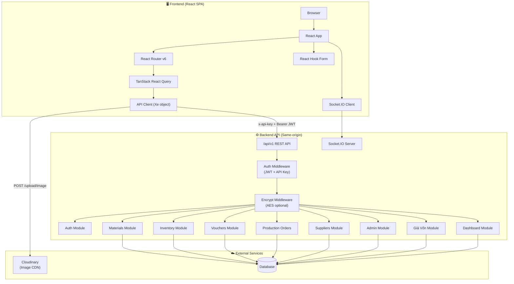
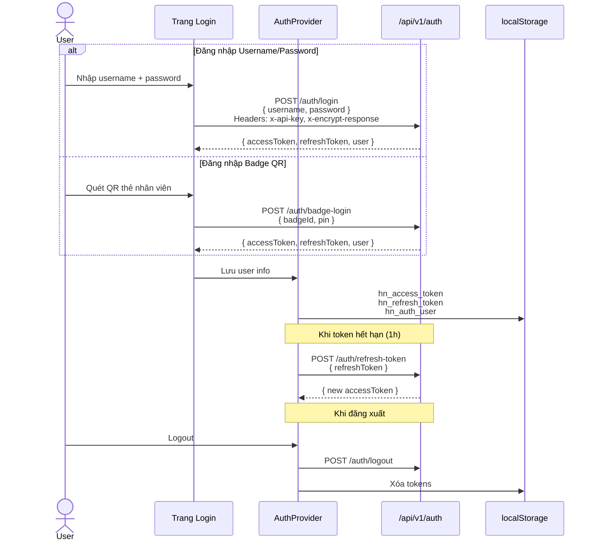
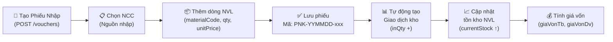
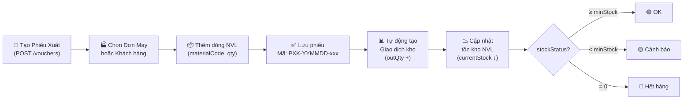
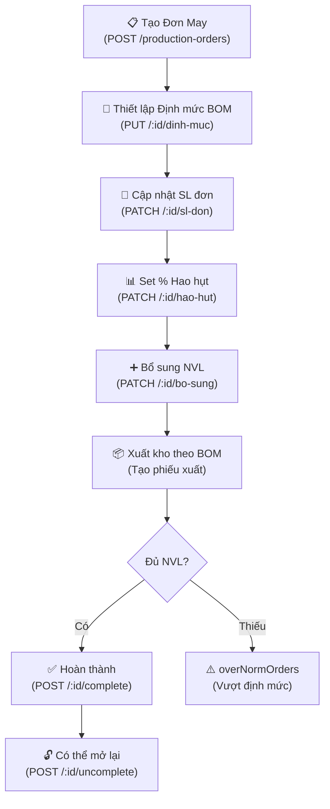
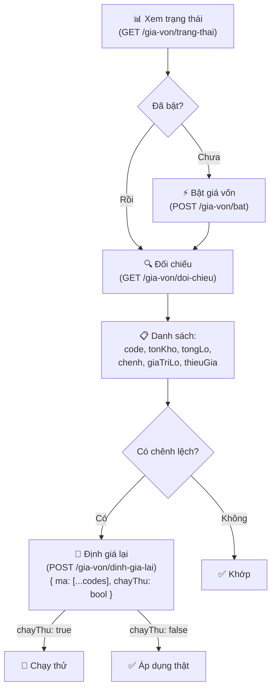
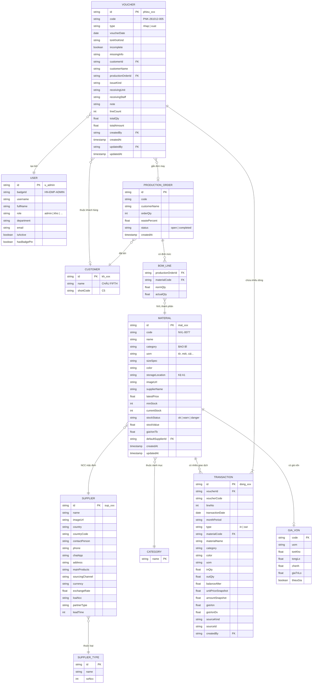
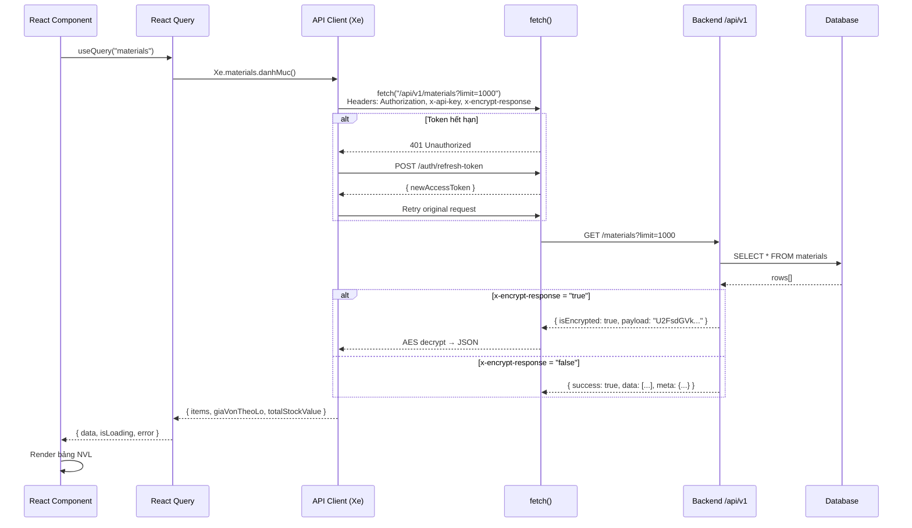
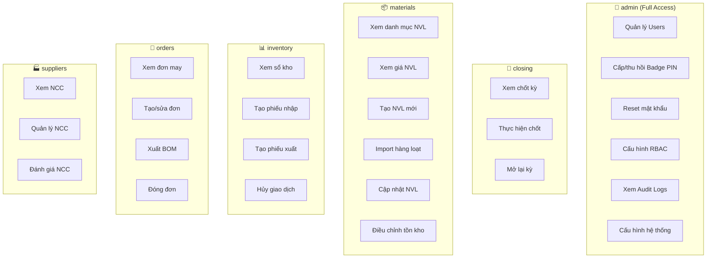

# 📐 Sơ Đồ Hệ Thống Hoàng Nhật SCM Dashboard

> **Lưu ý (14/10/2026):** tài liệu này viết cho phiên bản cũ (backend Python `server.py`, triển khai Render/PostgreSQL). Kiến trúc hiện tại (Node.js/TypeScript, Prisma + SQLite, Docker Compose + Caddy trên EC2) xem `README.md` và `docs/DEPLOY.md`. Phần mô tả chức năng nghiệp vụ vẫn còn giá trị tham khảo.

---

## 1. Sơ đồ Kiến trúc Tổng quan



---

## 2. Luồng Authentication



---

## 3. Luồng Nghiệp vụ Chính

### 3.1 Luồng Nhập Kho



### 3.2 Luồng Xuất Kho



### 3.3 Luồng Đơn May & BOM



### 3.4 Luồng Giá Vốn



---

## 4. Sơ đồ Chức năng (Feature Map)

```mermaid
flowchart TD
    Root["🏠 Hoàng Nhật SCM\ndashboard.hoang-nhat.com"]

    Root --> Login["🔐 Đăng nhập\n/login"]
    Root --> Dashboard["📊 Dashboard\n/"]
    Root --> Kho["📦 Kho\n/kho"]
    Root --> NhapKho["📥 Nhập kho\n/nhap-kho"]
    Root --> XuatKho["📤 Xuất kho\n/xuat-kho"]
    Root --> SoKho["📒 Sổ kho\n/so-kho"]
    Root --> DanhMuc["🗂️ Danh mục NVL\n/danh-muc-nvl"]
    Root --> DonMay["🧵 Đơn may\n/don-may"]
    Root --> NCC["🏭 Nhà cung cấp\n/nha-cung-cap"]
    Root --> KH["👥 Khách hàng\n/khach-hang"]
    Root --> CaiDat["⚙️ Cài đặt\n/cai-dat"]

    Login --> L1["Username / Password"]
    Login --> L2["Badge QR + PIN"]

    Dashboard --> D1["KPI tổng hợp"]
    Dashboard --> D2["Biểu đồ xu hướng"]
    Dashboard --> D3["Phân bổ theo danh mục"]
    Dashboard --> D4["Đơn vượt định mức"]
    Dashboard --> D5["Phiếu chưa hoàn tất"]

    Kho --> K1["Xem tồn kho"]
    Kho --> K2["Lọc: OK / Cảnh báo / Hết"]
    Kho --> K3["Kiểm kê\n/kho/kiem-ke"]

    NhapKho --> N1["Tạo phiếu nhập"]
    NhapKho --> N2["Chọn NCC nguồn"]
    NhapKho --> N3["Thêm dòng NVL + giá"]
    NhapKho --> N4["Xem lịch sử phiếu"]

    XuatKho --> X1["Tạo phiếu xuất"]
    XuatKho --> X2["Xuất theo đơn may"]
    XuatKho --> X3["Xuất cho khách"]

    SoKho --> S1["Sổ kho tổng hợp"]
    SoKho --> S2["Lọc theo kỳ/NVL"]
    SoKho --> S3["Xuất Excel"]

    DanhMuc --> DM1["CRUD nguyên vật liệu"]
    DanhMuc --> DM2["Import Excel hàng loạt"]
    DanhMuc --> DM3["Upload ảnh Cloudinary"]
    DanhMuc --> DM4["Quản lý danh mục"]
    DanhMuc --> DM5["Gán NCC mặc định"]

    DonMay --> DO1["Tạo đơn may mới"]
    DonMay --> DO2["Chi tiết /don-may/:id"]
    DO2 --> DO3["Thiết lập BOM"]
    DO2 --> DO4["Set SL đơn + hao hụt"]
    DO2 --> DO5["Bổ sung NVL"]
    DO2 --> DO6["Hoàn thành / Mở lại"]

    NCC --> NC1["CRUD nhà cung cấp"]
    NCC --> NC2["NCC Trung Quốc"]
    NCC --> NC3["Phân loại NCC (12 loại)"]
    NCC --> NC4["Đánh giá NCC"]

    KH --> KH1["CRUD khách hàng"]
    KH --> KH2["Mã rút gọn (shortCode)"]

    CaiDat --> CD1["Quản lý Users"]
    CaiDat --> CD2["Cấp / Thu hồi Badge PIN"]
    CaiDat --> CD3["Reset mật khẩu user"]
    CaiDat --> CD4["Đổi mật khẩu cá nhân"]
    CaiDat --> CD5["Giá vốn (bật/tắt/đối chiếu)"]
    CaiDat --> CD6["Chất lượng dữ liệu"]
```



---

## 5. ER Diagram (Quan hệ dữ liệu)



---

## 6. Cấu trúc Tệp Source Code (Tái dựng)

> [!NOTE]
> Cấu trúc bên dưới được **tái dựng (reconstructed)** từ phân tích JS bundle minified, KHÔNG phải source code thật. Dựa trên: tên routes, API client, component patterns, và conventions của React + Vite.

```
hoang-nhat-scm-dashboard/
├── 📄 index.html
├── 📄 vite.config.ts
├── 📄 tailwind.config.ts
├── 📄 tsconfig.json
├── 📄 package.json
│
├── 📁 public/
│   ├── logo-icon.png
│   └── favicon.ico
│
├── 📁 src/
│   ├── 📄 main.tsx                          # Entry point, mount React
│   ├── 📄 App.tsx                           # Root component, Router setup
│   │
│   ├── 📁 api/                              # API Client Layer
│   │   ├── 📄 client.ts                     # fetch wrapper (dt function)
│   │   │                                    #   - baseUrl = "/api/v1"
│   │   │                                    #   - x-api-key header
│   │   │                                    #   - x-encrypt-response header
│   │   │                                    #   - auto-refresh JWT
│   │   ├── 📄 repository.ts                 # Xe object — full API client
│   │   │   ├── materials.*                  #   GET/POST/DELETE /materials
│   │   │   ├── transactions.*               #   GET /inventory/transactions
│   │   │   ├── vouchers.*                   #   CRUD /vouchers
│   │   │   ├── customers.*                  #   CRUD /customers
│   │   │   ├── productionOrders.*           #   CRUD /production-orders
│   │   │   ├── suppliers.*                  #   CRUD /suppliers
│   │   │   ├── supplierTypes.*              #   CRUD /supplier-types
│   │   │   ├── categories.*                 #   CRUD /categories
│   │   │   ├── admin.*                      #   GET /admin/*
│   │   │   ├── giaVon.*                     #   GET/POST /gia-von/*
│   │   │   ├── taiKhoan.*                   #   PATCH /auth/doi-mat-khau
│   │   │   └── dashboard.*                  #   GET /dashboard/stats
│   │   ├── 📄 errors.ts                     # RepositoryError class (Fa)
│   │   └── 📄 upload.ts                     # POST /upload/image → Cloudinary
│   │
│   ├── 📁 auth/                             # Authentication
│   │   ├── 📄 AuthProvider.tsx              # Context + useAuth hook
│   │   │                                    #   - login(username, password)
│   │   │                                    #   - loginWithBadge(badgeId, pin)
│   │   │                                    #   - logout()
│   │   │                                    #   - auto-refresh token
│   │   ├── 📄 constants.ts                  # hn_auth_user, hn_access_token, etc.
│   │   └── 📄 storage.ts                    # localStorage / sessionStorage helpers
│   │
│   ├── 📁 pages/                            # Route Pages
│   │   ├── 📁 login/
│   │   │   └── 📄 LoginPage.tsx             # /login — form + badge scanner
│   │   │
│   │   ├── 📁 dashboard/
│   │   │   └── 📄 DashboardPage.tsx         # / — KPI, trends, categories breakdown
│   │   │
│   │   ├── 📁 kho/
│   │   │   ├── 📄 KhoPage.tsx              # /kho — bảng tồn kho, filter stockStatus
│   │   │   └── 📄 KiemKePage.tsx           # /kho/kiem-ke — form kiểm kê
│   │   │
│   │   ├── 📁 danh-muc-nvl/
│   │   │   └── 📄 DanhMucNvlPage.tsx       # /danh-muc-nvl — CRUD NVL, import bulk
│   │   │
│   │   ├── 📁 nhap-kho/
│   │   │   └── 📄 NhapKhoPage.tsx          # /nhap-kho — tạo/xem phiếu nhập
│   │   │
│   │   ├── 📁 xuat-kho/
│   │   │   └── 📄 XuatKhoPage.tsx          # /xuat-kho — tạo/xem phiếu xuất
│   │   │
│   │   ├── 📁 so-kho/
│   │   │   └── 📄 SoKhoPage.tsx            # /so-kho — sổ kho, xuất Excel
│   │   │
│   │   ├── 📁 don-may/
│   │   │   ├── 📄 DonMayListPage.tsx       # /don-may — danh sách đơn
│   │   │   └── 📄 DonMayDetailPage.tsx     # /don-may/:id — BOM, định mức, hao hụt
│   │   │
│   │   ├── 📁 nha-cung-cap/
│   │   │   └── 📄 NhaCungCapPage.tsx       # /nha-cung-cap — CRUD NCC + loại
│   │   │
│   │   ├── 📁 khach-hang/
│   │   │   └── 📄 KhachHangPage.tsx        # /khach-hang — CRUD khách hàng
│   │   │
│   │   └── 📁 cai-dat/
│   │       └── 📄 CaiDatPage.tsx           # /cai-dat — users, badge, giá vốn
│   │
│   ├── 📁 components/                       # Shared UI Components
│   │   ├── 📄 Layout.tsx                    # layout-dashboard — sidebar + header
│   │   ├── 📄 Sidebar.tsx                   # Navigation menu
│   │   ├── 📄 DataTable.tsx                 # Bảng dữ liệu chung
│   │   ├── 📄 FormDialog.tsx                # Dialog form (react-hook-form)
│   │   ├── 📄 ImageUploader.tsx             # Upload ảnh Cloudinary
│   │   ├── 📄 ExcelExporter.tsx             # Xuất BaoCao_Kho_HoangNhat_*.xlsx
│   │   ├── 📄 QrScanner.tsx                # Quét QR thẻ nhân viên
│   │   ├── 📄 StockStatusBadge.tsx          # Badge: ok/warn/danger
│   │   └── 📄 ProtectedRoute.tsx            # Auth guard + permission check
│   │
│   ├── 📁 hooks/                            # Custom Hooks
│   │   ├── 📄 useAuth.ts                    # Auth context consumer
│   │   ├── 📄 useMaterials.ts               # useQuery → materials
│   │   ├── 📄 useSuppliers.ts               # useQuery → suppliers
│   │   ├── 📄 useVouchers.ts                # useQuery → vouchers
│   │   ├── 📄 useTransactions.ts            # useQuery → transactions
│   │   ├── 📄 useProductionOrders.ts        # useQuery → production-orders
│   │   └── 📄 useDashboardStats.ts          # useQuery → dashboard/stats
│   │
│   ├── 📁 utils/                            # Utilities
│   │   ├── 📄 excel.ts                      # SheetJS helpers (gne function)
│   │   ├── 📄 format.ts                     # Số, ngày, tiền tệ
│   │   ├── 📄 permissions.ts                # canViewSupplier, hasPermission
│   │   └── 📄 validators.ts                 # Regex: /^\d{4,6}$/ etc.
│   │
│   └── 📁 types/                            # TypeScript Types
│       ├── 📄 material.ts
│       ├── 📄 supplier.ts
│       ├── 📄 voucher.ts
│       ├── 📄 transaction.ts
│       ├── 📄 production-order.ts
│       ├── 📄 customer.ts
│       ├── 📄 user.ts
│       └── 📄 dashboard.ts
│
└── 📁 server/                               # Backend (suy luận)
    ├── 📄 index.ts                          # Express/Fastify server
    ├── 📁 middleware/
    │   ├── 📄 auth.middleware.ts             # JWT verify + x-api-key check
    │   └── 📄 encrypt.middleware.ts          # AES encrypt response (CryptoJS)
    ├── 📁 routes/
    │   ├── 📄 auth.routes.ts                # /auth/*
    │   ├── 📄 materials.routes.ts           # /materials/*
    │   ├── 📄 inventory.routes.ts           # /inventory/*
    │   ├── 📄 vouchers.routes.ts            # /vouchers/*
    │   ├── 📄 production-orders.routes.ts   # /production-orders/*
    │   ├── 📄 suppliers.routes.ts           # /suppliers/*
    │   ├── 📄 categories.routes.ts          # /categories/*
    │   ├── 📄 customers.routes.ts           # /customers/*
    │   ├── 📄 admin.routes.ts               # /admin/*
    │   ├── 📄 gia-von.routes.ts             # /gia-von/*
    │   ├── 📄 dashboard.routes.ts           # /dashboard/*
    │   └── 📄 upload.routes.ts              # /upload/* → Cloudinary
    └── 📁 services/
        ├── 📄 auth.service.ts
        ├── 📄 material.service.ts
        ├── 📄 inventory.service.ts
        ├── 📄 voucher.service.ts
        ├── 📄 gia-von.service.ts            # Tính giá vốn trung bình
        └── 📄 cloudinary.service.ts
```

---

## 7. Luồng Request/Response



---

## 8. Tổng hợp Chức năng theo Quyền (RBAC)


